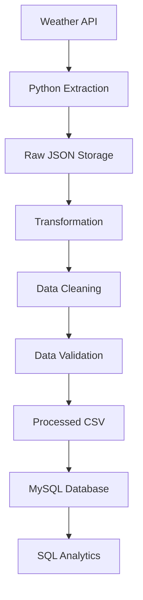

# 🌦️ Weather Data Pipeline

### End-to-End ETL Pipeline | Python | Weather API | MySQL | Data Engineering

---

## 📌 Project Overview

The **Weather Data Pipeline** is an end-to-end data engineering project designed to collect weather information from an external weather API, process and transform the raw responses into structured datasets, and store the cleaned data in a MySQL database for further analysis.

The project demonstrates the fundamental stages of a data engineering workflow: **data extraction, transformation, validation, and loading (ETL)**.

Weather data is collected for multiple cities, converted into a consistent structure, validated, and prepared for analytical use. The pipeline separates raw API responses from processed datasets, making the data easier to manage, debug, reprocess, and analyze.

The primary objective of this project is to build a reliable and modular data pipeline that demonstrates practical data engineering skills using Python, API integration, data processing, and relational database storage.

---

## 🎯 Project Objectives

- Extract real-time weather information from an external API.
- Collect weather data for multiple cities.
- Store original API responses in a Raw data layer.
- Transform API responses into structured records.
- Handle missing and inconsistent data.
- Validate weather records before loading.
- Load processed records into MySQL.
- Prevent duplicate observations through database constraints.
- Maintain modular and reusable Python code.
- Build a foundation for future analytics and dashboard development.

---

## 🏗️ Pipeline Architecture

The pipeline follows a modular ETL architecture.



### Pipeline Flow

1. **Source:** Retrieve weather information from an external API.
2. **Extraction:** Python sends API requests for configured cities.
3. **Raw Storage:** Original API responses are stored as JSON.
4. **Transformation:** Extract relevant weather attributes and normalize the structure.
5. **Validation:** Check required fields and data consistency.
6. **Processed Storage:** Store transformed data in structured CSV format.
7. **Loading:** Insert validated records into MySQL.
8. **Analytics:** Query the database using SQL for analysis.

---

## 🔄 ETL Workflow

### 1. Extract — Data Collection

The extraction component connects to the weather API and retrieves weather observations for configured cities.

The pipeline is designed to support multi-city collection using configuration-driven city lists.

The extraction process includes:

- API request handling
- City-based weather collection
- Response retrieval
- API error handling
- HTTP response validation
- Raw JSON preservation

The extraction component is designed to be independent of the transformation and loading modules.

### 2. Raw Data Storage

Raw API responses are stored before transformation.

The Raw layer preserves the source response and provides a reference for downstream processing.

**Benefits:**

- Reprocessing without repeatedly calling the API
- Traceability to source responses
- Easier debugging
- Data auditing
- Separation of source data and transformed data

### 3. Transform — Data Processing

The transformation module converts API responses into a structured tabular format.

Processing activities include:

- Extracting required fields
- Standardizing column names
- Normalizing city information
- Converting values into appropriate data types
- Handling missing values
- Preparing records for database insertion
- Maintaining a consistent schema

### 4. Data Quality and Validation

Before loading data into the database, the pipeline performs validation to ensure that records meet basic quality requirements.

Validation may include:

- Required fields are present.
- City names are available.
- Temperature values are numeric.
- Humidity values are valid.
- Weather timestamps are available.
- Data types are consistent.
- Invalid records are identified.

Records that fail validation should be excluded from the loading stage or retained separately for investigation.

### 5. Load — MySQL Integration

Validated weather records are loaded into a MySQL database.

The database provides structured storage for weather observations and supports SQL queries for analysis.

The loading component is separated from extraction and transformation to improve modularity and maintainability.

Database operations include:

- Establishing a database connection
- Creating or using the target schema
- Inserting validated records
- Handling duplicate observations
- Managing database errors

---

## 📂 Data Layers

The project uses a simple layered data organization.

### Raw Layer

Stores original API responses in JSON format.

```text
data/raw/
```

Purpose:

- Preserve original API data
- Maintain source traceability
- Support reprocessing
- Enable debugging

### Processed Layer

Stores cleaned and normalized weather records.

```text
data/processed/
```

Purpose:

- Standardized data
- Consistent schema
- Validated records
- Database-ready datasets

### Database Layer

Stores structured weather observations in MySQL.

Purpose:

- Persistent structured storage
- SQL querying
- Analytical exploration
- Historical observation management

---

## 🌍 Multi-City Weather Collection

The pipeline is designed to collect weather observations for multiple cities using a centralized configuration file.

Example cities:

- Rewa
- Bhopal
- Indore
- Delhi
- Mumbai
- Bengaluru

City configuration is maintained separately from application logic to make it easier to add or remove locations without changing the core Python code.

---

## 📊 Weather Data Fields

The pipeline extracts relevant weather attributes from API responses.

| Field | Description |
|---|---|
| City | City name |
| Country | Country identifier, when available |
| Temperature | Current temperature |
| Feels Like | Perceived temperature |
| Humidity | Relative humidity |
| Pressure | Atmospheric pressure |
| Weather Description | General weather condition |
| Wind Speed | Wind speed |
| Observation Time | Timestamp of the observation |
| API Timestamp | Time data was collected by the pipeline |

The exact fields depend on the API response and the implemented schema.

---

## 🗄️ MySQL Database

MySQL is used as the structured storage layer for processed weather data.

The database schema is maintained using SQL scripts.

### Database Benefits

- Structured storage
- Relational querying
- Data integrity
- Duplicate prevention
- Filtering and aggregation
- Integration with analytical tools

### Example SQL Analysis

**Average temperature by city**

```sql
SELECT
    city,
    AVG(temperature) AS avg_temperature
FROM weather_observations
GROUP BY city;
```

**Highest temperature recorded**

```sql
SELECT
    city,
    MAX(temperature) AS max_temperature
FROM weather_observations
GROUP BY city
ORDER BY max_temperature DESC;
```

**Humidity comparison**

```sql
SELECT
    city,
    AVG(humidity) AS avg_humidity
FROM weather_observations
GROUP BY city
ORDER BY avg_humidity DESC;
```

**Latest observation for each city**

```sql
SELECT *
FROM weather_observations
ORDER BY observation_time DESC;
```

*SQL examples may need adjustments depending on the final table schema and database version.*

---

## 🧰 Technology Stack

| Technology | Purpose |
|---|---|
| Python | Pipeline development |
| Weather API | External data source |
| Requests | API communication |
| JSON | Raw API response storage |
| Pandas | Data transformation |
| MySQL | Structured data storage |
| SQL | Data analysis |
| Git | Version control |
| GitHub | Repository hosting |

---

## 📁 Project Structure

```text
Weather_Data_Pipeline/
│
├── README.md
├── requirements.txt
├── .env.example
├── .gitignore
│
├── config/
│   └── cities.json
│
├── data/
│   ├── raw/
│   │   └── API responses in JSON format
│   │
│   └── processed/
│       └── cleaned weather records
│
├── src/
│   └── weather_pipeline/
│       ├── __init__.py
│       ├── config.py
│       ├── extract.py
│        ├── transform.py
│       ├── load_mysql.py
│       └── pipeline.py
│
├── sql/
│   └── schema.sql
│
├── docs/
│   ├── architecture.md
│   └── data_dictionary.md
│
├── reports/
│   └── pipeline reports
│
└── tests/
    └── test_transform.py
```

---

## ⚙️ Configuration Management

The project uses configuration files to separate settings from the Python application code.

The city configuration allows the pipeline to collect data from multiple locations.

Environment variables are used to manage sensitive configuration such as:

- API keys
- Database host
- Database username
- Database password
- Database name
- Connection settings

Sensitive credentials should never be hardcoded or committed to GitHub.

A `.env.example` file provides a template for the required environment variables.

---

## 🧪 Testing

Testing is an important component of pipeline reliability.

The project includes unit testing for transformation logic and data validation.

Testing focuses on:

- Valid weather API records
- Missing required fields
- Incorrect data formats
- Transformation consistency
- Normalization logic
- Handling invalid input records

The tests are designed to validate pipeline components independently of live API availability.

---

## 📈 Analytical Use Cases

The processed weather data can support multiple analytical use cases.

### City-Level Weather Comparison

Compare weather conditions across different cities.

### Temperature Monitoring

Analyze temperature variations across observations and locations.

### Humidity Analysis

Identify cities with relatively high or low humidity.

### Weather Condition Distribution

Analyze the frequency of different weather conditions.

### Historical Weather Trends

As observations accumulate, explore changes in weather metrics over time.

### Data Integration

Weather data can eventually be combined with other datasets such as energy consumption, mobility, logistics, or environmental data.

---

## 🚀 How to Run the Project

### 1. Clone the Repository

```bash
git clone https://github.com/prakashjaypandey/Weather_Data_Pipeline.git
cd Weather_Data_Pipeline
```

### 2. Create a Virtual Environment

```bash
python -m venv venv
```

Activate on Windows:

```powershell
venv\Scripts\activate
```

### 3. Install Dependencies

```bash
pip install -r requirements.txt
```

### 4. Configure Environment Variables

Create a local `.env` file using `.env.example` as the template.

Configure the required API and database credentials.

### 5. Configure Cities

Update the city configuration file:

```text
config/cities.json
```

Add or remove cities according to your collection requirements.

### 6. Create the MySQL Database

Execute the SQL schema file:

```text
sql/schema.sql
```

Ensure that MySQL is running and the configured user has the required permissions.

### 7. Execute the Pipeline

Run the pipeline entry point:

```bash
python -m weather_pipeline.pipeline
```

The exact execution command may vary depending on the package setup and the repository implementation.

---

## 🔐 Security Considerations

- API keys are managed through environment variables.
- Database credentials are not stored in source code.
- `.env` files are excluded from Git.
- Database access should use appropriate permissions.
- API requests should follow provider rate limits.
- Error messages should not expose credentials.
- Raw data should be stored with appropriate access controls.

---

## ⚠️ Error Handling and Reliability

The pipeline considers common failure scenarios:

- API connection failures
- HTTP errors
- Invalid JSON responses
- Missing API fields
- Unexpected data types
- Database connection failures
- Duplicate records
- Invalid observations

The modular architecture allows individual components to be tested and improved without redesigning the entire pipeline.

---

## 🔮 Future Enhancements

- [ ] Automate pipeline execution on a schedule.
- [ ] Implement historical data collection.
- [ ] Add retry mechanisms for API failures.
- [ ] Improve logging and monitoring.
- [ ] Implement incremental data loading.
- [ ] Add data freshness checks.
- [ ] Implement duplicate handling and upserts.
- [ ] Add Docker containerization.
- [ ] Orchestrate workflows using Apache Airflow.
- [ ] Store raw data in Amazon S3.
- [ ] Transform data using AWS Glue or PySpark.
- [ ] Add Power BI dashboards.
- [ ] Implement historical weather analytics.
- [ ] Add pipeline execution reports.
- [ ] Improve automated testing and data quality checks.

---

## 🎓 Learning Outcomes

This project demonstrates practical understanding of:

- ETL pipeline development
- API integration
- Python programming
- Data extraction
- Data transformation
- Data validation
- JSON handling
- Multi-city data collection
- MySQL integration
- SQL analytics
- Modular programming
- Database schema design
- Error handling
- Configuration management
- Unit testing
- Data engineering workflows

---

## 👨‍💻 Author

**Jay Prakash Pandey**

Computer Science Graduate | Aspiring Data Engineer

**Technical Interests**

- Data Engineering
- Python
- SQL
- AWS
- Big Data
- ETL / ELT
- Data Pipelines
- Cloud Data Platforms

🔗 **LinkedIn:** [jaypandey10](https://linkedin.com/in/jaypandey10)

💻 **GitHub:** [prakashjaypandey](https://github.com/prakashjaypandey)

---

## 📌 Project Status

This repository is an educational and portfolio project demonstrating a modular weather data pipeline.

The project is designed to evolve from local API ingestion and MySQL storage toward automated orchestration, cloud storage, scalable processing, and analytical reporting.

---

⭐ **Built to explore how raw weather API data can be transformed into reliable, structured, and analytics-ready information through data engineering.**
